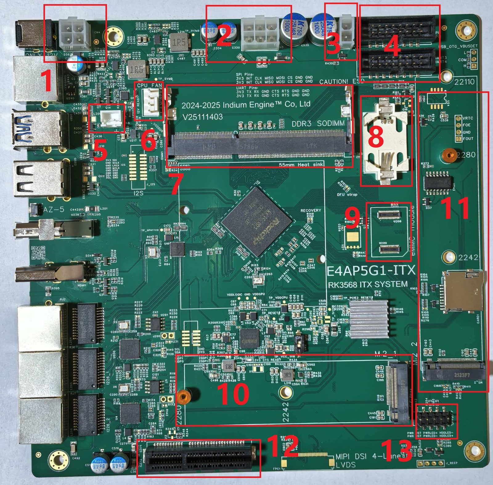
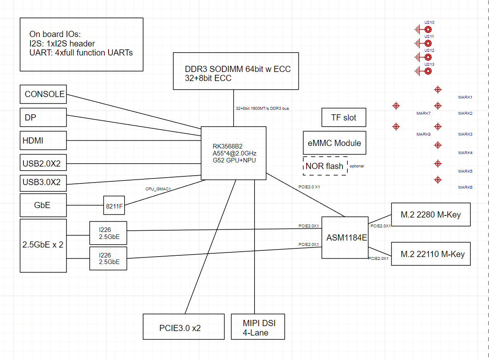
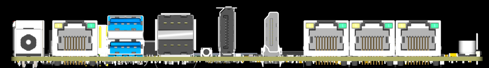
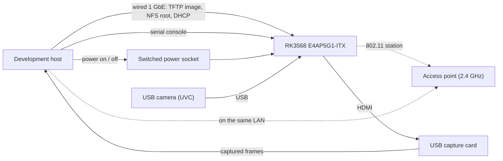

# RK3568-E4AP5G1-ITX (the reference board)

Every hardware result in this project comes from one board: an **IndiumEngine
RK3568-E4AP5G1LTS-ITX** (the vendor's own short name is "E4AP5G1-ITX"), a small
server board built on the Rockchip RK3568B2 SoC. This document describes the
board, the pin and PHY multiplexing it exposes, and exactly which connectors and
peripherals this project drives, so that the wiring behind a hardware result is
answerable from the repository alone.

*Board top view. The callout numbers are the connector list of the board
vendor's user manual; the silkscreen reads "E4AP5G1-ITX / RK3568 ITX SYSTEM".*

## The board

| | |
|---|---|
| Board | IndiumEngine RK3568-E4AP5G1LTS-ITX; device-tree compatible `rockchip,rk3568-e4ap5g1-itx` |
| SoC | Rockchip RK3568B2, 4x Arm Cortex-A55 (64-bit), Mali-G52 GPU, NPU |
| Memory | One DDR3 SODIMM slot; side-band ECC is on by default, so half the module's capacity is spent on ECC |
| Storage | An eMMC module socket and, optionally, SPI-NOR flash; the SD socket is a recovery path, not the boot medium |
| Power | 12 V DC in (6-16 V accepted), typical board power around 6 W |

The board is dense for its size, and a good part of its I/O hangs off a PCIe
packet switch rather than the SoC's own controllers. That matters when reading
the tables below: "on the board" and "on the SoC" are not the same thing here.

*Board block diagram: which block hangs off the SoC directly and which sits
behind the PCIe switch.*

*Rear I/O, left to right: DC input, console, two USB 3.0 ports (the upper one is
the maskrom/OTG download port), DP, HDMI, one 1 GbE port, two 2.5 GbE ports.*

## On-board peripherals

| Block | Instance | Base address | Notes |
|---|---|---|---|
| Console UART | uart2 | `0xfe660000` | RS232 rear console, 115200 8N1; the firmware's `stdout-path` |
| Ethernet | gmac0 | `0xfe2a0000` | RGMII to an RTL8211F PHY |
| Ethernet | gmac1 | `0xfe010000` | RGMII to an RTL8211F PHY; the 1 GbE rear port |
| 2.5 GbE | 2x Intel i226 | (PCIe) | reached through the PCIe switch, not a SoC MAC |
| SD / MMC | sdmmc0 | `0xfe2b0000` | The 4-bit card socket; wired for 3.3 V signalling only |
| eMMC | sdhci | -- | 8-bit, 52 MHz; the module socket |
| Boot flash | sfc (SPI-NOR) | -- | Optional; carries the boot FIT on boards that use it |
| USB 2.0 | usb_host0/1 ehci + ohci | `0xfd800000`, `0xfd880000` | Two USB 2.0 ports |
| USB 3.0 | usb_host0/1 xhci | `0xfd000000`, `0xfcc00000` | Two USB 3.0 ports; one doubles as the OTG download port |
| PCIe 3.0 | pcie3x2 | -- | x2 electrical, x16 mechanical slot |
| PCIe 2.0 | -- | -- | Lanes to the M.2 sockets and to the PCIe switch |
| Display | HDMI, DP, MIPI DSI | -- | HDMI and DP on the rear panel |
| Power monitor | INA3221 | i2c1, `0x40` | Three-rail (3V3 / 5V / 12V) monitor, the board's power meter |
| RTC | RX8025 | i2c1, `0x32` | CR2032 backed |
| PMIC | RK809 + SYR827 | i2c0, `0x20` / `0x40` | System rails and the CPU regulator |

The base addresses above are the ones this project's board support actually
programs; they are recorded in
[../../board/rk3568-itx/board_conf.h](../../board/rk3568-itx/board_conf.h) and the
per-driver headers.

## Pin and PHY multiplexing

The RK3568 exposes three **combo PHYs** (the SoC calls them MPHY0..2). Each one
can be routed to USB 3.0 SuperSpeed, SATA, or PCIe, so the same physical pins
carry different protocols depending on the board's wiring and the firmware's
configuration:

| Combo PHY | Board usage |
|---|---|
| MPHY0 (combphy0) | USB 3.0 or SATA, selected at run time |
| MPHY1 (combphy1) | USB 3.0 or SATA, selected at run time |
| MPHY2 (combphy2) | USB 3.0, SATA or PCIe |

Two GPIO lines select the SATA side of the mux: `multiphy_mux_sel0` on GPIO0_A5
and `multiphy_mux_sel1` on GPIO0_A6. The device tree additionally uses the
per-PHY property `rockchip,dis-u3otgN-port` to switch off the USB 3.0 side of a
combo PHY when that PHY is given to SATA. On the board's 3-SATA variant both mux
selects are driven to select SATA.

The PCIe 3.0 x2 slot does **not** use a combo PHY: it has its own dedicated PHY
(`pcie30phy`). A board port that assumes the slot is behind `combphy2` will
probe nothing.

The remaining multiplexing is ordinary pin muxing, declared as pin groups:

| Pin group | Pins / function |
|---|---|
| `gmac0_*` | RGMII (MIIM, TX/RX bus, RGMII clock) for gmac0 |
| `gmac1m0_*` | RGMII for gmac1, mux option 0 |
| `sdmmc0_*` | 4-bit SD bus, clock, command, card detect (GPIO0_A4) |
| `emmc_*` | 8-bit eMMC bus, clock, command, data strobe |
| `fspi_*` | SPI-NOR flash |
| `uart2_*` | Console UART |
| GPIO controls | USB power enables, PCIe reset (GPIO2_D6), PCIe 3V3 enable (GPIO0_D4), PMIC interrupt (GPIO0_A3), user LED (GPIO4_C1) |

## What this project drives

This is the part that matters for reading a result: which board connector the
project uses, and which code in this tree owns it. Line status is in
[../../README.md](../../README.md); this table is only the hardware mapping.

| Board connector | Project use | Code in this tree |
|---|---|---|
| Rear console (uart2) | The board console: the boot firmware's prompt and the RTOS shell | `board/rk3568-itx/drivers/uart.c` |
| Rear 1 GbE port (gmac1) | The management link: image download over TFTP, NFS root, DHCP | `board/rk3568-itx/drivers/dwc_eqos.c`, `rtl8211f.c` |
| SD socket (sdmmc0) | The SDIO WiFi part (RTL8189FTV). The socket is wired to the module rather than to a removable card | `ports/fsl_sdmmc/`, `board/rk3568-itx/drivers/dwc_mmc.c` |
| USB ports | Three USB WiFi adapters -- RTL8188EUS (`rtl8xxxu`), RTL8821CU (`rtw88`), RTL8851BU (`rtw89`) -- and the USB camera (UVC) | `ports/cherryusb/` |
| Rear HDMI | Display output; the bench captures it through a USB capture card | video line, in progress |
| DC input | Switched by an external, network-controlled power socket, so the bench can power-cycle the board without touching it | bench only |

The board's PCIe slot, M.2 sockets, 2.5 GbE ports and eMMC module are not driven
by any code in this tree yet; the eMMC and SPI-NOR only ever appear as boot
media, configured by the firmware and not by the RTOS image.

## The bench wiring

Every hardware result is produced on the bench below: one development host, the
board, an access point the board associates with, and the two links that let the
host drive the board without a keyboard.

- **Wired link.** The host and the board are on the same LAN over the board's
  1 GbE port. The firmware pulls the image over TFTP; a Linux root filesystem
  (when the round needs one for comparison) comes over NFS. This link is the
  management path, not part of the wireless data path.
- **Serial console.** The host owns the board's serial console. It is how the
  boot firmware is driven, how an RTOS image is selected and started, and how a
  board regression round's transcript is collected.
- **Wireless.** The board associates with the access point as a station. The
  host sits on the same LAN, so host-to-board traffic crosses the AP: the
  host-to-board direction is the AP-to-station direction.
- **Power.** The board's DC input is behind a network-controlled switch, so a
  cold power cycle (the reset of record for a boot result) is done from the host.
- **Camera.** A USB camera is attached to the board; the board's HDMI output
  goes to a USB capture card on the host, which is how the video line is
  checked without a monitor.

## Image provenance

The board photographs and the block diagram under `docs/boards/rk3568-e4ap5g1-itx/` are reproduced
from the board vendor's user manual for the RK3568-E4AP5G1-ITX, to document the
hardware this project targets. They are not first-party assets and are not
covered by the project's own license; see [../../LICENSES.md](../../LICENSES.md).
